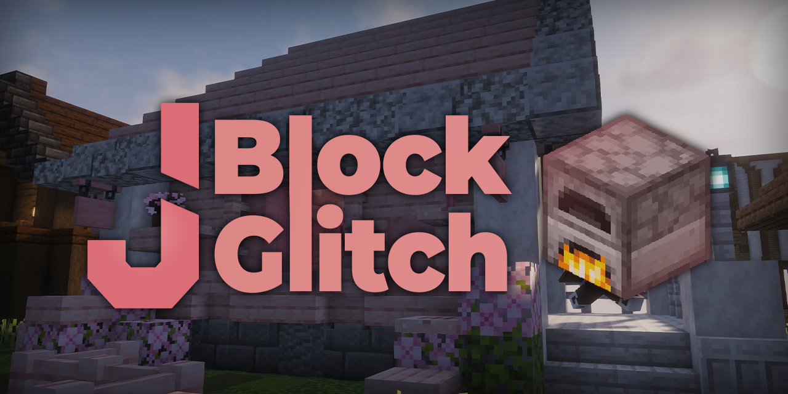
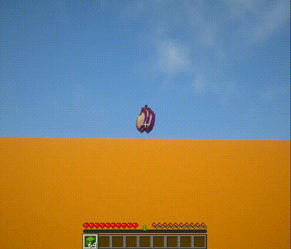
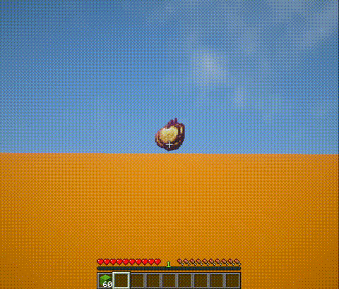
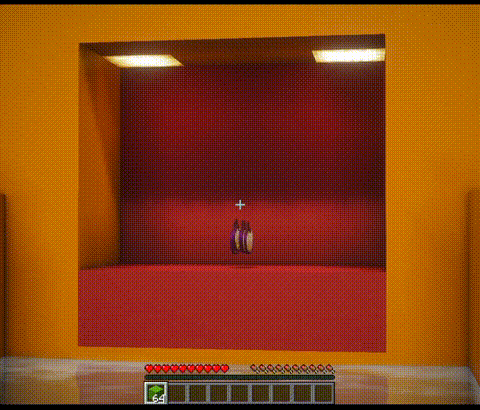
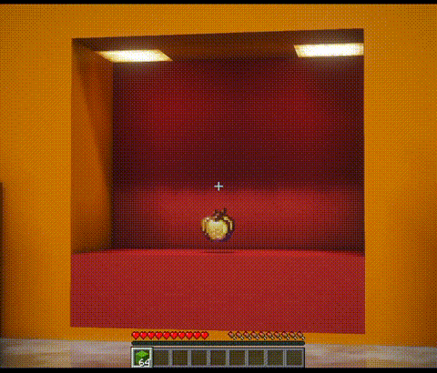

# Getting Started

## Requirements

- Paper 26.2 or newer
- Java 25

## Installation

1. Download a release jar from
   [Modrinth](https://modrinth.com/plugin/jblockglitch) (or build it
   with `.\gradlew.bat build`).
2. Place the jar in your server's `plugins/` folder.
3. Restart the server. The plugin generates `config.yml`, `messages.yml`
   and `sounds.yml` in `plugins/JBlockGlitch/`.
4. (Optional) Install [PlaceholderAPI](https://www.spigotmc.org/resources/placeholderapi.6245/)
   to use `%placeholders%` inside the plugin messages.

## Your First Commands

```text
/jblockglitch help
/jblockglitch version
/jblockglitch config
/jblockglitch reload
```

`/jbg` is a built-in alias for `/jblockglitch`. `/jbg config` lists
every tunable setting; `/jbg config <key> [value]` shows or changes
one live, with tab completion.

!!! note "Upgrading from an older config"
    The configuration files were rewritten from scratch (`config.yml`,
    `messages.yml`, `sounds.yml`). Old files are not migrated: back
    yours up, delete them, and let the plugin generate the new schema
    on first start. The key mapping is documented in
    [configuration](configuration.md).

## What It Protects Against

The plugin runs two independent detection systems, each with its own
enable flag and mode in [configuration](configuration.md).

**Protected-block glitch prevention** catches placements denied by
protection plugins such as WorldGuard or GriefPrevention, whether they
cancel the block place event or the interaction itself. Normal blocks
and buckets (water, lava, powder snow) are covered. `medium`
rubberbands the player to their previous position; `strict` uses
additional movement and position detection to keep them out of the
denied block.

**Vanilla ghost item and ghost block prevention** detects common
ghost item creation techniques (inventory manipulation with F+Q,
hotbar switching, item drops, block placement). `medium` watches the
well-known patterns, `hard` additionally monitors every inventory
interaction including creative mode, and `brute-force` resyncs every
inventory every tick. A periodic nearby-block resync clears
client-side ghost blocks for players who moved.

## Demos

Plugin configured to `medium` detection mode. Tests done with an
autoclicker at 100 CPS.

### Protected Region

Without the plugin, this 10-second demonstration shows the
block-placement glitch:



With the plugin, the same placement attempt fails:



### Vanilla Ghost Item

Without the plugin, this 10-second demonstration shows ghost item
generation:



With the plugin, the ghost item generation fails:



## Next Steps

- [Commands](basics/commands.md)
- [Configuration](configuration.md)
