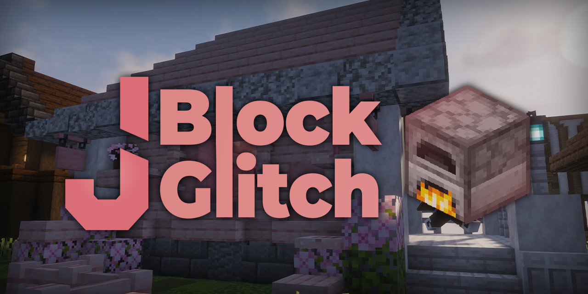

# JBlockGlitch

A lightweight Paper plugin that prevents players from creating ghost
items and from block glitching in protected regions: commands (Paper
native Brigadier), okaeri-configs, MiniMessage messaging, sounds and
an async update checker -- all wired without a DI framework.

## Key Features

- **Protected-block prevention** -- resends the real block state when a
  protection plugin denies a placement, and stops movement through the
  client-side ghost block (`medium` and `strict` modes).
- **Ghost item prevention** -- detects vanilla ghost item techniques
  (F+Q, hotbar switching, drops, creative inventory tricks) and forces
  a client resync (`medium`, `hard` and `brute-force` modes).
- **Ghost block resync** -- periodically resends the blocks around
  moving players to clear client-side ghosts.
- **Small modules** -- one package per concern, each self-contained and
  easy to extend.
- **Manual wiring** - a registrar per module (`Bootstrap`) composes
  services; `JBlockGlitchPlugin` is the single composition root.
- **Update checker** -- async GitHub releases check with console and
  in-game notices, including per-severity toggles.
- **Reloadable** -- `/jblockglitch reload` re-reads every config and
  re-registers listeners without a restart.

## Documentation

- [Getting Started](getting-started.md)
- [Commands](basics/commands.md)
- [Permissions](advanced/permissions.md)
- [Configuration](configuration.md)
- [Extending JBlockGlitch](advanced/extending.md)

## Build

Java 25 is required.

```text
./gradlew build
```

The plugin jar is written to `build/libs/`.
